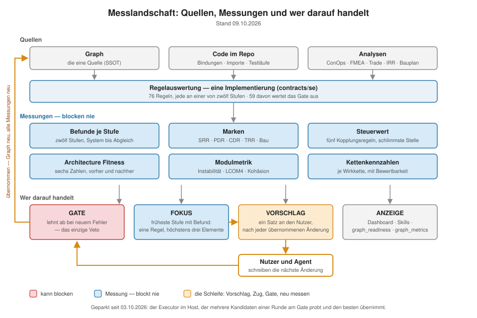

# Kennzahlen — was gerechnet wird, wo, und wer darauf handelt

Die Leitlinie (`docs/graphcode_leitlinie.md`) trägt Claims, DoD und Testdefinitionen. Diese Datei
trägt die **Definition** jeder Größe: die Frage des Nutzers, die Rechenstelle, den, der handelt, und die Quelle
des Verlaufs. Sie nennt keinen Messwert. Den gemessenen Wert, den Vorwert und den Stand je Woche
schreibt `npm run messung` nach [`stand.md`](stand.md), je Release. Erzählend: `docs/articles/07-the-scoring-landscape.md`.

**Grundsatz:** Für jede Zahl gilt **eine** Definition, **eine** Rechenstelle, **ein** Konsument, der
darauf handelt. Wonach niemand handelt, ist keine Kennzahl und steht hier nicht.

Eine Regelauswertung → vier Projektionen · zwei unabhängige Messfamilien (Topologie) ·
ein abgeleiteter Steuervektor. Handeln dürfen genau drei: **Gate**, **Treiber** (Auswahl → nächster
Prompt), **Anzeige** — dazu die Stufe **Empfehlen** (Leitlinie §3), die als einzige lernen darf.

## Die zwölf Größen

Jede Größe beantwortet eine Frage des Nutzers. Der Verlauf kommt aus einer von vier Quellen:

| Quelle | Wo sie liegt | Wie weit sie zurückreicht |
|---|---|---|
| Git-Historie | `docs/graph/*.graph.json`; `graph_readiness({verlauf: n})` rechnet jeden committeten Stand mit denselben Funktionen wie der Live-Stand (CR-GC-946) | jeder Commit, der den Graphen änderte |
| Zeile je CR | `docs/messung/testauswahl.jsonl`, geschrieben von `npm run verify:full <CR>` (CR-GC-718, CR-GC-947) | jeder CR, der den Volllauf fuhr |
| `audit_stats` | MCP-Werkzeug; Parameter `since` begrenzt das Fenster (CR-GC-943) | das Audit-Protokoll des Repos |
| `.graphcode/cr-messung.jsonl` | lokal, nicht im Git; der Hook `post-commit` schreibt eine Zeile je CR und Sitzung | jeder CR, der auf dieser Maschine geschlossen wurde |

Jede Größe hat genau eine dieser Quellen.

### 1 · Marken SRR bis Bau

- **Frage:** Wie reif ist mein Modell?
- **Definition:** Eine Marke ist erreicht, wenn bis zu ihrer Stufe kein Fehler und kein offener Existenz-Befund bleibt. Hinweise halten keine Marke. Bau hält zusätzlich jede Warnung der Stufen 10 bis 12.
- **Rechenstelle:** `computeMarks` in `@sigloch/graphcode-client`; Feld `marks` von `graph_readiness`.
- **Wer handelt:** Anzeige. Den Übergang zur nächsten Stufe entscheidet der Autor.
- **Verlauf:** Git-Historie.

### 2 · Befunde je Stufe, Plan getrennt

- **Frage:** Kommt die Arbeit voran?
- **Definition:** Die Zahl offener Befunde je Stufe. Die Stufe Plan steht für sich: ihre Befunde wachsen mit der Arbeit am Modell und zählen nicht ins Urteil.
- **Rechenstelle:** `countByStage` in `@sigloch/graphcode-client`; Feld `stages` von `graph_readiness`.
- **Wer handelt:** Der Schreiber des Modells, Skill `se:close-violations`.
- **Verlauf:** Git-Historie.

### 3 · Steuerwert, Überschreitungen je Steuerregel

- **Frage:** Wo ist der Schnitt am schlechtesten?
- **Definition:** Der Steuerwert ist die größte Überschreitung einer Steuerregel (Chebyshev). Je Regel stehen die Zahl der Terme und die Zahl der Überschreitungen daneben. Steuerregeln: RD-04, BW-02, R-04, CR-01, MT-02.
- **Rechenstelle:** `STEER_RULES` in se-engine; `takeSteeringSnapshot` und `steerSpaceOf` im Kernel; Feld `steer` von `graph_readiness`.
- **Wer handelt:** Treiber (Rangkriterium nach der Zerstörungssperre, CR-GC-483) und Fertig-Kriterium.
- **Verlauf:** Git-Historie, je Regel unter `steer.byRule`.

### 4 · Testergebnis je Anforderung

- **Frage:** Ist belegt, was gefordert ist?
- **Definition:** Je Anforderung: alle Tests bestanden, ein Test rot, oder nie gelaufen. Ein Ergebnis gilt nur aus einem Lauf (`graph_test_ingest`).
- **Rechenstelle:** `verificationReport`; dieselbe Rechnung wie `graph_test_report`.
- **Wer handelt:** Der Schreiber des CR: rote und nie gelaufene Anforderungen.
- **Verlauf:** Git-Historie.

### 5 · Ketten bewertbar

- **Frage:** Sind die Kettenanalysen möglich?
- **Definition:** Bewertbare Ketten ÷ alle Ketten. Eine nicht bewertbare Kette zählt im Nenner mit und nennt statt einer Zahl den Grund (`answerPathBlockedBy`).
- **Rechenstelle:** `chainMetrics` in `@sigloch/contracts/se`; Feld `measurability` von `graph_metrics`.
- **Wer handelt:** Der Schreiber des Modells.
- **Verlauf:** Git-Historie.

### 6 · Schlupf, bereinigt

- **Frage:** Spart der Graph Testzeit?
- **Definition:** Schlupf ist ein roter Test im Volllauf, der außerhalb der Auswahl lag, die `verify:code` für dieselbe Änderung trifft. Bereinigt: Dateien, die im Link-Modus erwartet rot sind, zählen nicht (Feld `umgebung`). Gelesen wird die Folge der CRs der Spur CODE ohne Schlupf; bei `SCHLUPF_SCHWELLE` Folgegliedern entfällt der Volllauf je CR.
- **Rechenstelle:** `schlupfVon` und `schlupfFreieFolge` in `src/projections/test-schlupf.ts`; geschrieben von `scripts/verify-full.mjs`.
- **Wer handelt:** Der Autor: er entscheidet über den Wegfall des Volllaufs je CR.
- **Verlauf:** Zeile je CR.

### 7 · Bindung der Blackbox- und Schnittstellen-Tests

- **Frage:** Trägt die Zusage hinter der Auswahl?
- **Definition:** Tests der Blackboxen und ihrer Schnittstellen mit Laufadresse (`testRefs`) ÷ alle diese Tests. Was innerhalb einer Blackbox läuft, kennt die Blackbox selbst; in der Auswahl ist das der direkte Import. Kriterium: 100 % (`CLAUDE.md`, Abschnitt Test discipline).
- **Rechenstelle:** `blackboxBindung` in `src/projections/test-schlupf.ts`; die Zeile nennt die offenen Tests unter `zusage.*.offen`.
- **Wer handelt:** Der Schreiber des CR: er bindet die offenen Tests.
- **Verlauf:** Zeile je CR.

### 8 · Grenzmenge

- **Frage:** Passt das Modell zum Code?
- **Definition:** FUNC und SCHEMA, die eine MOD-Grenze kreuzen, im Modell ÷ Pflichtmenge. Untergrenze, keine Gleichheit: Was unterhalb der Grenze bleibt, ist Blackbox; „jede Datei im Modell" ist kein Ziel. Kriterium: 100 % (T-V4).
- **Rechenstelle:** `messeGrenzmenge` in `scripts/grenzmenge.mjs`.
- **Wer handelt:** Der Schreiber des CR: er modelliert die fehlenden Symbole.
- **Verlauf:** Zeile je CR (Feld `grenzmenge`). Den Stand je Release nennt `stand.md` in der Zeile T-V4.

### 9 · Dauer Auswahl gegen Volllauf

- **Frage:** Spart der Graph Testzeit?
- **Definition:** Laufzeit je Testdatei, summiert, für die Dateien der Auswahl und für alle. Parallele Dateien addieren sich: die Summe ist Rechenzeit, nicht Wanduhrzeit.
- **Rechenstelle:** `dauerVon` in `src/projections/test-schlupf.ts`.
- **Wer handelt:** Der Autor, zusammen mit Größe 6.
- **Verlauf:** Zeile je CR (Feld `dauer`).

### 10 · Werkzeuglatenz

- **Frage:** Ist das Werkzeug schnell genug?
- **Definition:** Median der Runde „lesen → Status → Vorschlag → Anwenden" an einer festen Eingabe. Das lebende Modell wächst; eine Schwelle darauf wäre eine Schwelle auf das Modellwachstum. Kriterium: unter 200 ms (T-E8).
- **Rechenstelle:** `tests/perf.advisory-roundtrip.spike.test.ts`; `scripts/messung.mjs` liest den Messpunkt `fixed`.
- **Wer handelt:** Der Autor des Hosts.
- **Verlauf:** `stand.md`, je Release; die Git-Historie der Datei trägt die Reihe.

### 11 · Ablehnungsquote je Regel und je Skill, Feuerbild je Regel

- **Frage:** Helfen Regeln und Skills?
- **Definition:** Abgelehnte Züge ÷ alle Züge, getrennt je Regel (`byRule`) und je Skill (`bySkill`). Das Feuerbild nennt je Regel `evaluatedIn` (Züge, in denen die Regel lief) und `firedIn` (Züge mit einem Fund). Die Lesart steht unten.
- **Rechenstelle:** `audit_stats` (CR-GC-943).
- **Wer handelt:** Der Autor der Regel (contracts) oder der Autor des Skills, je nach Bild.
- **Verlauf:** `audit_stats` mit `since`.

**Was die Ablehnungsquote sagt.** Sie misst die Güte von Regeln und Skills, nicht die des Modells. Für beide
gilt dieselbe Lesart, und nur die getrennte Zahl trägt sie:

| Bild | Befund | Wer handelt |
|---|---|---|
| Eine Regel lehnt oft ab, über alle Skills | Regel oder ihr Hilfetext ist unklar | Autor der Regel (contracts) |
| Ein Skill wird oft abgelehnt, über mehrere Regeln | der Skill lehrt einen falschen Zug | Autor des Skills |
| Die Quote eines Skills fällt im Verlauf | der Skill wird besser | — |
| Keine Ablehnung, die Warnungen steigen | die Regeln sind zu weich | Autor der Regel |

Die Gesamtquote ohne Trennung (2026-11-15: 32 von 369 Zügen) trägt keine dieser Aussagen. `audit_stats` liefert
beide Zahlen: je Regel unter `byRule`, je Skill unter `bySkill` (CR-GC-943). Den Skill nennt der Schreiber als
Parameter `skill` von `graph_mutate`; die Angabe ist keine Messung. Ein Zug ohne Parameter steht unter
`skill: null` und heißt „nicht erfasst", nicht „kein Skill". Das gilt für jeden Zug vor dem 2026-11-15.

**Was das Feuerbild einer Regel sagt.** `audit_stats` nennt je Regel zwei Zahlen: `evaluatedIn`, die Zahl der
Züge, in denen die Regel lief, und `firedIn`, die Zahl der Züge, in denen sie einen Fund hatte. Mit `since`
ergibt das den Verlauf. Die Messung urteilt nicht; die Lesart steht hier:

| Bild | Zahlen | Befund | Wer handelt |
|---|---|---|---|
| Nie gelaufen | `firedIn: null` | das Gate führt die Regel nicht (am 2026-11-15: RC, ND, BQ); sie läuft nur in `rules_evaluate` | — |
| Lief, nie ein Fund | `firedIn: 0` | die Regel prüft etwas, das in diesem Repo nicht vorkommt, oder ihre Schwelle ist abgeschaltet (MT-01: `null`) | Autor der Regel oder der Policy, erst nach dem Blick über mehrere Repos |
| Fund in fast jedem Zug | `firedIn` nahe `evaluatedIn`, über Wochen | Warnung ohne Wirkung: Schwelle falsch, oder niemand handelt | Autor der Regel oder der Policy |
| Blockt oft | `blocked` hoch | siehe Ablehnungsquote | Autor der Regel |

„Nie" gilt für ein Repo. Ob eine Regel überall stumm ist, zeigt erst derselbe Blick über mehrere Repos.
`evaluatedIn` ist `null`, sobald ein Zug des Fensters keine bestandenen Regeln führt (Züge vor CR-GC-314).

### 12 · `graph_impact` bei CRs mit Löschung

- **Frage:** Führt der Graph den Agenten?
- **Definition:** Je CR: Hat ein Commit mit der CR-ID Dateien gelöscht (`loeschung`)? Wenn ja: Rief die Sitzung im Fenster des CR `graph_impact` (`impactBeiLoeschung`)? Das Kriterium aus T-C3 lautet „vor dem Löschzug"; gemessen wird der Aufruf im Fenster, nicht seine Reihenfolge. Das Fenster beginnt mit der ersten Nennung der CR-ID im Sitzungsprotokoll und endet mit dem Abschluss des CR. Ohne Protokoll steht `impactBeiLoeschung: null`.
- **Rechenstelle:** `scripts/cr-messung.mjs` (Hook `post-commit`); die Zählung steht in `werkzeugNutzung` in `scripts/retro-kpi.mjs`.
- **Wer handelt:** Der Autor des Skills `se-umbau`.
- **Verlauf:** `.graphcode/cr-messung.jsonl`. Die Zeile T-E1 in `stand.md` fasst die jüngsten CRs mit Löschung zusammen.

## Weitere Rechengrößen — Gate, Treiber, Anzeige

Diese Größen beantworten keine Frage des Nutzers allein; sie speisen Gate, Treiber oder Anzeige.

| Größe | Rechenstelle | Skala / Nenner | Handelt darauf |
|---|---|---|---|
| Regelverstoß | `contracts/se`; `SE_DESCRIPTOR` = SE-Profil | Zählung, `error` blockend | **Gate** (blockt) · **Treiber** (Fundfenster je `rule_id` → Prompt) |
| Creation-Freshness | graphcode-client | vorhanden + aktuell | **Gate** |
| `steeringDelta` | graphcode | Δ je Dimension, vor/nach Kandidat | **Treiber** (Rang 2 + 3) |
| Vorschläge (`graph_suggest`, `next`) | se-engine `suggestEdits` + `FIX_TEMPLATES`, Operatoren | je Befund ein Zug, am Gate geprobt | **Empfehlen** (Agent entscheidet; T-M5) |
| Architecture Fitness ℝ⁶ | se-engine (`fitAdvisory`) | 6 Topologiewerte, ganzer Teilgraph | **Anzeige** — seit CR-GC-483 nur berichtet. Modellarchitektur ist **Nebenbedingung**, nicht Zielgröße (Leitlinie §5); das Vorzeichen ist nicht belegt (T-O4 No-Go) |
| `moduleMetrics` je MOD | `contracts/se/metric-rules` | `[0,1]` / ℕ / `[0,1]`; `null` = nicht messbar | **Anzeige** (Ist gegen Zielwert) · speist MT-01/MT-02 |
| Kettenkennzahlen je FCHAIN | `scripts/spike-kettenkennzahlen.mjs` (Spike) | acht Kennzahlen (Leitlinie §5) | **Anzeige** — noch kein Treiber; Realisierungsarchitektur wird nur an der FCHAIN bewertet (T-O1, T-O2) |
| `functionCriticality` je FUNC | `contracts/se/function-criticality` | ℕ Ketten / ℕ Use Cases; `0` ist eine **Aussage**, kein fehlender Wert | **Anzeige** (Blast Radius, Kritikalität, Rollout); zweiter Abnehmer ist R-21s Infrastruktur-Ausnahme ab CR-SM-313 |
| `intentCoverage` | graphcode | je Thema adressiert / nicht | **Treiber** (`isIntentTooThin`, Prompt-Kontext) |

## Retro-KPIs — Standardauswertung nach einem Projekt (CR-GC-212)

Misst, ob der Graph tatsächlich benutzt wurde (nicht per grep umgangen) und ob das Gate die
Qualität gehoben hat. Die KPIs rechnet `scripts/retro-kpi.mjs` (Logik in `tests/retro-kpi.test.ts`),
aufgerufen über den Skill `se-retro`. Quellen: MCP (Audit- und Readiness-Werkzeuge),
git und das Sitzungsprotokoll — nie ein zweiter DB-Handle. Die Nummern sind die des Skripts; die Ablehnungsquote
ist Größe 11, die Grenzmenge Größe 8, `graph_impact` bei Löschung Größe 12.

| KPI | Definition | Quelle | Kriterium |
|---|---|---|---|
| **2 Werkzeugnutzung** | Zahl der Aufrufe `graph_mutate` / `graph_impact` / `graph_expand` / `rules_evaluate` | `audit_trail`, Protokoll | — (Profil) |
| **3 Tokens je Netto-LOC** | Tokens ÷ (eingefügt − gelöscht) | Protokoll + `git diff` | ↓ |
| **4 Plantreue** | Zahl der CRs, die ihre `depends-on`-Reihenfolge verletzen | Graph + CR-Daten (`deriveImplPlan`, CR-GC-209) | **0** |
| **6 Bindung (Knoten)** | R-19 / R-20 (`testRefs` / `realRef`) zum Abschluss | `rules_evaluate` | **100 %** (T-V4: Bindungsquote) |

**Warum Bindung zweimal.** R-19/R-20 sind Regeln je Element: sie prüfen die Knoten, die es gibt, und
sehen nicht, was nie modelliert wurde. Am eigenen Repo lasen sie 0 Befunde (KPI 6 = 100 %), während
nur 48 von 106 Testdateien und 19 von 63 Quelldateien überhaupt einen Knoten trugen
(SPIKE-GC-selective-tests, 2026-08-21). Die Knotenseite sagt *das Modell ist in sich vollständig*,
die Grenzmenge sagt *das Modell deckt, was die Architektur trägt*. `scripts/test-selection-audit.mjs`
misst weiter die Datei-Deckung aller Tests — als Reichweite der Testauswahl (T-E7), nicht als Ziel.

**Warum diese.** Die erste echte Anwendung (graphify) hinterließ Anzeichen einer Umgehung — ein nie
exportiertes 231-KB-`kuzu.wal`, kein committetes `graph.json`, die CR-Reihenfolge als Prosa in
`CLAUDE.md` —, aber messbar war es nicht, weil es keine KPI gab.

## Läufe des Rigs — ein Datensatz je Lauf (CR-GC-739)

Rig und Auswertung leben seit CR-GC-764 im privaten Repo graphanalyze. Was ein Lauf des Rigs war, steht dort als
Datensatz in `docs/messung/benchmark.jsonl` und gerendert in `benchmark.md`; die Größen und ihre Eingänge definiert
dort `auswertung/README.md` (Kennzahlen, Verhalten, Schatten-Vorschläge, Blindurteil).
Eine Größe davon bleibt hier, weil die Leitlinie sie als Test führt:

| Größe | Definition | Kriterium |
|---|---|---|
| Dubletten | neuer Knoten mit ≥ 70 % Wortgleichheit (gleicher Name: ≥ 40 %) zu einem Knoten desselben Typs, je Kommando, jeder Typ; Schablonentext getrennt | Leitlinie T-E11 |

Die Executor-Züge der S2-Runden (Lösungsquote je Fokusregel, neue Fokusfunde, Regel-Pareto; CR-GC-708/709) sind
mit dem Greenfield-Rig gefallen (CR-GC-740); ihre Definitionen und der Kennzahlverlauf liegen unter
[`docs/archive/messung-executor/`](../archive/messung-executor/verlauf.md).

## Schwellen — zwei Ebenen, nie im Code

Keine Urteilsschwelle steht als Literal im Regelcode. Sie steht auf einer von zwei Ebenen, und die
Zuordnung entscheidet, **wer sie ändern darf**:

| Ebene | Inhalt | Wer setzt sie | Charakter |
|---|---|---|---|
| **1 — Verfahren** (graphcode) | Maße des Messgeräts: ND-Ähnlichkeit, BQ-04-Ähnlichkeit, Schema-Overlap; die unvalidierten Startwerte von MT-01/MT-02, CR-01, R-04 | mit dem Werkzeug ausgeliefert, versioniert | **Startwerte**, nicht durch Messreihen belegt. Änderung = Messgerät ändern, gehört in eine Release-Notiz |
| **2 — Zielarchitektur** (Projekt) | Was dieses Projekt erreichen will: Instabilität, LCOM4, Crossing Flows, Fokus-Schwelle, Risiko-RPN, Randbreite (Modul wie Whitebox), Zerlegungsbreite, Infrastruktur-Schwelle | der Mensch, je Repo | **Ziel**. Änderung = Anspruch ändern, gehört ins Projektprotokoll |

Beide liegen in `graphcode.config.jsonc`, getrennt ausgewiesen. `null` heißt auf beiden Ebenen
„messen, nicht urteilen" — und ist auf Ebene 1 der Weg, einen unbelegten Startwert loszuwerden,
ohne die Zahl zu verlieren. Jede Schwelle verlässt den Host **mit** der Größe, über die sie urteilt.

## Ein Satz, den das Diagramm nicht zeigt

- **Zwei Wörter „Kohäsion":** `cohesion` (LCOM4) misst Kanten innerhalb der *erklärten* Modulgrenze
  (in flow-geführten Architekturen nahe 0 → bewusst schwellenlos), ℝ⁶-coherence misst
  *algorithmisch gefundene* Cluster. Zwei Fragen, ein Wort.

## Eine Schwelle je Frage

„Ist diese Dimension zu schwach?" wird genau einmal beantwortet — von der Fokus-Schwelle aus der
Config. Ein zweiter Wert für dieselbe Frage (ein `ready`-Flag neben einer Generator-Schwelle) ist
per Definition ein Widerspruch, kein Komfort.

## Gestrichen: was keinen Konsumenten hat

`overallScore` (Mittel über gestartete Dimensionen), das `ready`-Flag und der Gewichtsvektor D1–D6
werden gerechnet und von nichts gelesen — kein Gate, kein Treiber, keine Anzeige. Sie sind Reste des
aimprove-Prompt-Scorers. Entweder bekommt eine davon einen handelnden Konsumenten, oder sie fällt
(CR-SM-233 · CR-SM-235 · CR-GC-329).

Zusammengeführt aus `docs/KPI.md` und `docs/MESSGROESSEN.md` (CR-GC-680); getrennt von `stand.md` mit CR-GC-948.

@author andreas@siglochconsulting
