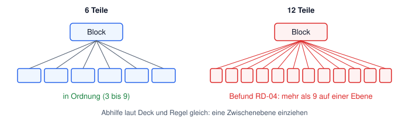
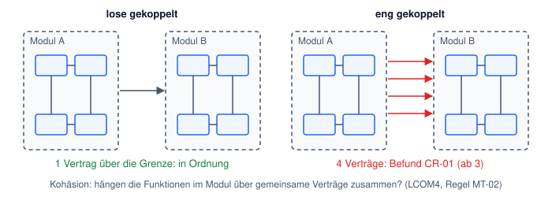
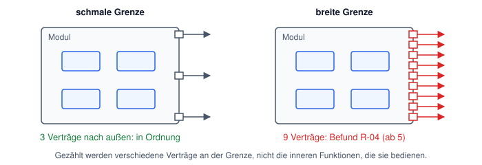
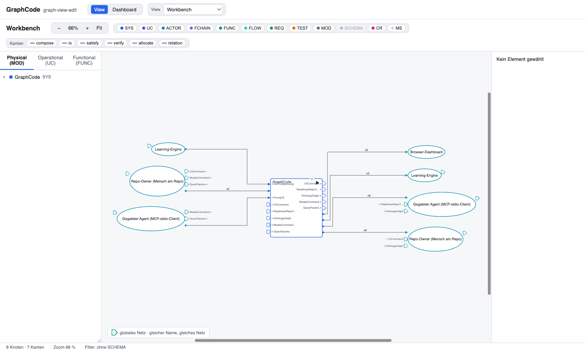
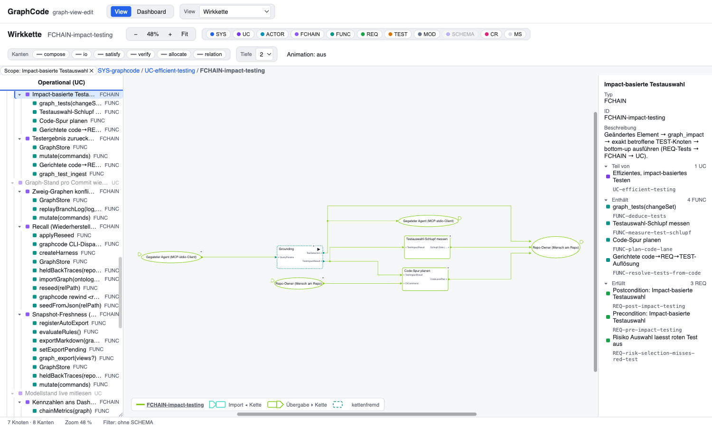
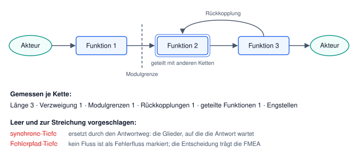
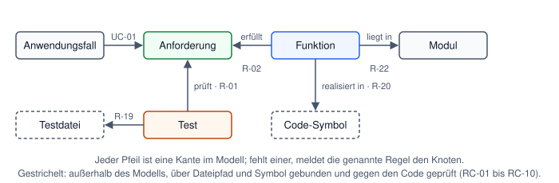

# Architekturregeln: Deck von 2023 gegen graphcode heute

**Stand:** 2026-10-12, Modellversion 740 von graphcode selbst.
**Quelle:** „How to create a good architecture".
**Frage:** Welche Regeln des Decks prüft graphcode heute selbst, womit, und was fehlt?

## Ergebnis

- Das Deck beschreibt Regeln, die ein Architekt kennen und ein Review prüfen soll. graphcode prüft
  die meisten davon bei jeder Änderung am Modell automatisch und nennt den betroffenen Knoten.
- Von den acht Designregeln sind fünf gemessen (Bündelung, lose Kopplung, hohe Kohäsion, Kapselung,
  Modularität). Abstraktion und Trennung der Belange sind teilweise gedeckt. Für „Design for Change"
  gibt es keine eigene Regel, und es braucht auch keine (Abschnitt 6).
- Die sechs Modellschritte des Decks und die Rückverfolgbarkeit bis zum Code sind vollständig
  gedeckt. Das ist der stärkste Bereich.
- Zwei Kennzahlen an den Wirkketten sind leer und zur Streichung vorgeschlagen (ITEM-2026-882).

## Lesehilfe

| Wort hier | Im Deck | Im Modell |
|---|---|---|
| Funktion | system function | `FUNC` |
| Modul | realization element | `MOD` |
| Vertrag | Schnittstelle, Signal | `SCHEMA` an einem Fluss (`FLOW`) |
| Wirkkette | customer effect chain | `FCHAIN` |
| Befund | Abweichung im Review | Meldung einer Regel, zum Beispiel RD-04 |

Die Kennungen in Klammern (RD-04, R-04, CR-01) sind Regeln aus dem gemeinsamen Katalog
`@sigloch/contracts/se`. Die Schwellen stehen in der Metrik-Policy des Repos und sind einstellbar.

---

## 1. Die acht Designregeln (Folien 25 bis 34)

### 1.1 Bündelung

**Deck:** Ein Element zerfällt auf der nächsten Ebene in 7 ± 2 Teile, mindestens zwei. Höchstens
7 ± 2 Ebenen.

**graphcode:** Die Breite je Ebene ist eine Regel. Mehr als 9 Kinder meldet RD-04, zu wenige
meldet RD-05 (Schwelle hier: 3). Heute 5 Befunde, darunter der Funktionsblock „Abfrage" mit 12
Unterfunktionen.

**Offen:** Die Zahl der Ebenen wird nicht geprüft. Sie folgt aus der Breite und der Zahl der Blätter,
eine eigene Regel wäre dieselbe Aussage ein zweites Mal.

### 1.2 Lose Kopplung

**Deck:** So wenige Abhängigkeiten wie möglich, so viele wie nötig.

**graphcode:** Gezählt werden die verschiedenen Verträge zwischen je zwei Modulen. Ab 3 meldet
CR-01, heute an 13 Modulpaaren. Zyklen meldet R-12. Im Code hält ein Test die Importrichtung
(`tests/import-boundaries.test.ts`), und RC-05 meldet Importe, die das Modell nicht kennt.

### 1.3 Hohe Kohäsion

**Deck:** Ein Element dient genau einer Aufgabe; zusammen liegt, was inhaltlich zusammengehört.

**graphcode:** LCOM4 je Modul (MT-02) und je Funktionsblock (MT-04). Die Zahl sagt, in wie viele
unverbundene Gruppen die Funktionen zerfallen; 1 heißt zusammenhängend. Heute liegt kein Modul über
der Schwelle, ein Funktionsblock („Host & Sitzung") zerfällt in 5 Gruppen.

**Grenze:** Gemessen wird der Zusammenhang über gemeinsame Verträge. Ob die Aufgabe inhaltlich *eine*
ist, bleibt ein Urteil des Autors.

### 1.4 Kapselung

**Deck:** Schnittstellen nach außen sind eindeutig definiert und geben nur das Nötige heraus.
Empfohlen ist ein Eintrittspunkt („Fassade").

**graphcode:** Jeder Fluss trägt einen Vertrag (R-10), jeder Vertrag ist ein Zod-Schema im Code und
wird an der modellierten Grenze geparst (R-26, RC-04, RC-08, RC-09) und hat einen Test (R-32).
Die Breite der Grenze ist eine Regel: ab 5 verschiedenen Verträgen meldet R-04 das Modul und BW-02
den Funktionsblock. Heute 6 Module und 13 Funktionsblöcke.

**Offen:** Die Fassade selbst wird nicht geprüft, also nicht, wie viele innere Funktionen die
Grenze bedienen. Solange die Breite klein bleibt, ist auch diese Zahl klein.

### 1.5 Modularität

**Deck:** Zerlegung in abgegrenzte, in sich geschlossene Bausteine ohne Überschneidung. Die
meisten Schnittstellen liegen innen, wenige außen.

**graphcode:** Jede Funktion liegt in einem Modul und jedes Modul hat Funktionen (R-22, R-23).
Beinahe-Duplikate von Funktionen und Verträgen meldet ND-01 und ND-02. „Innen viel, außen wenig"
ist Kohäsion (1.3) und Kopplung (1.2) zusammen; ein eigenes Verhältnis wird nicht gebildet.

### 1.6 Abstraktion

**Deck:** Hierarchisch in Ebenen, vom Groben ins Feine. Ebenen sollen ausgewogen sein.

**graphcode:** Das Modell ist ein Baum aus Blöcken. Der Skill `se:top-level` führt von der Blackbox
abwärts, bis eine Funktion an Code gebunden ist. Die zwölf Reifestufen geben die Reihenfolge vor:
System, Anwendungsfall, Anforderung, Funktion, Fluss, Modul, Test, Code.

**Offen:** Ausgewogenheit der Ebenen (Größe, Symmetrie) wird nicht geprüft.

### 1.7 Trennung der Belange

**Deck:** Jeder Aspekt wird an genau einer Stelle behandelt. Geschnitten wird zuerst fachlich, dann
technisch, nur in begründeten Ausnahmen organisatorisch.

**graphcode:** „Genau eine Stelle" halten IO-02 (ein Fluss hat einen Erzeuger) und die
Duplikat-Regeln. Die Rangfolge fachlich vor technisch steckt im Aufbau: es gibt zwei getrennte
Bäume, den Funktionsbaum (fachlich) und den Modulbaum (technisch), und sie dürfen sich nicht
spiegeln.

**Grenze:** Ob ein Schnitt fachlich begründet ist, prüft keine Regel.

### 1.8 Design for Change

**Deck:** So lange wie möglich lösungsneutral bleiben; Vorhalte für absehbare Änderungen einplanen;
keine Blockade durch unnötige Vernetzung.

**graphcode:** Lösungsneutral bis spät ist die Stufenfolge aus 1.6: Module kommen nach den
Funktionen, Code am Ende. „Keine Blockade" ist messbar: `graph_impact` nennt vor jeder Änderung,
welche Wirkketten und Anforderungen sie trifft. Ein Vorhalt selbst ist eine Annahme über die Zukunft
und gehört als Anforderung ins Modell, nicht als Kennzahl.

---

## 2. Die sechs Modellschritte (Folien 14 bis 20)

| Schritt im Deck | graphcode | Regel, die es hält |
|---|---|---|
| 1. Blackbox mit Ein- und Ausgängen | ein System, Akteure an der Grenze | R-33, R-16, R-17 |
| 2. Funktionen zerlegen | Funktionsblöcke mit Unterfunktionen | RD-02, RD-04, RD-05 |
| 3. Funktionsfluss vervollständigen | jede Funktion hat Ein- und Ausgang und liegt in einer Kette | R-31, R-30, FC-05 |
| 4. Ein- und Ausgänge spezifizieren | jeder Fluss trägt einen Vertrag | R-10, IO-01, SC-02 |
| 5. Fehler und Fehlerbehandlung | Risiken als Anforderungen mit Gegenmaßnahme und Test (FMEA) | FM-01 bis FM-03 |
| 6. Funktionen auf Realisierung zuordnen | Funktion liegt in einem Modul und zeigt auf ein Code-Symbol | R-22, R-20 |

Schritt 1 am eigenen Modell, wie der Viewer es zeigt. Das System in der Mitte ist die Blackbox,
links und rechts stehen die vier Akteure mit ihren Verträgen.

*Viewer, Sicht „Workbench": 8 Knoten, 7 Kanten, Filter ohne Verträge.*

---

## 3. Beschreibung der Architektur (Folien 36 bis 40)

Das Deck verlangt vier Bilder. Der Viewer leitet sie aus dem Modell ab, gezeichnet wird keines.

| Bild im Deck | Sicht im Viewer |
|---|---|
| Kontextdiagramm | „Workbench" auf Systemebene (Bild oben) |
| Strukturdiagramm | „Workbench", Baum „Physical (MOD)" |
| Flussdiagramm | „Funktionsnetzwerk" |
| Kunden-Wirkketten | „Wirkkette" (Bild unten) |

Eine Wirkkette aus dem eigenen Modell: die Auswahl der Tests, die eine Änderung betrifft. Akteure
lösen aus (links) und erhalten das Ergebnis (rechts).

*Viewer, Sicht „Wirkkette", Kette `FCHAIN-impact-testing`: 7 Knoten, 8 Kanten, Filter ohne Verträge.*

Über die Bilder hinaus rechnet graphcode je Kette Kennzahlen. Heute sind 24 von 25 Ketten
bewertbar; die eine hat ein Glied ohne Ausgang.

---

## 4. Leitplanken und Best Practices (Folien 35, 48, 59, 60)

| Deck | graphcode | Stand |
|---|---|---|
| Rückverfolgbarkeit von der Anforderung bis zum Code | Kanten im Modell, je Kante eine Regel (Bild unten) | gedeckt |
| Selbstdokumentation: Erklärung am Baustein | Beschreibung am Knoten; die Sichten unter `docs/views` werden aus dem Modell erzeugt | gedeckt |
| Risiko nah am Ort der Wirkung abfangen | je Risiko die tragenden Funktionen; der Skill `se-vorbereitung` schlägt den tiefsten Träger vor | gemessen, ohne Regel |
| Kurze Wirkkette für sicherheitsrelevante Funktionen | Länge je Kette wird gemessen, ohne Schwelle und ohne Bezug zum Risiko | offen |
| Dieselbe Prüfung nicht an mehreren Stellen der Kette | nichts | offen |
| Selbstähnlichkeit: gleiche Muster, gleiche Namen | nichts | offen |
| Eigene Eingänge gehören zum eigenen System | Akteure haben Flüsse, Ketten laufen von Akteur zu Akteur (R-16, FC-04) | teilweise |
| Externe Schnittstelle braucht ein eigensicheres System | nichts | offen |

---

## 5. Fragen zur Architekturrelevanz (Folien 41 bis 43)

Das Deck fragt je System nach Zeitverhalten, Betriebszustand, Sicherheitsstufe, Varianten,
Aktualisierung im Feld und Anbindung an ein Backend. In graphcode ist das kein Fragebogen, sondern
ein Satz Schwellenwerte: nicht-funktionale Anforderungen an den Wirkketten, je Nutzungsprofil
(Leitlinie, Abschnitt 5).

| Frage im Deck | graphcode |
|---|---|
| Reaktionszeit, Leistung | Anforderung mit Budget an der Kette (NFR-01); der Skill `se-laufzeit` liest, auf welche Glieder die Antwort wartet |
| Sicherheitsstufe | Risiko mit Schwere, Auftreten, Entdeckung; hohe Priorität verlangt einen bestandenen Test (FM-03) |
| Backend, Nachbarsysteme | Akteure und Verträge an der Systemgrenze |
| Varianten, Skalierung über Baureihen | kein Modellelement |
| Aktualisierung im Feld | kein Modellelement |

---

## 6. Was offen bleibt und was daraus folgt

**Keine neuen Regeln für Ebenentiefe, Fassade und das Verhältnis innen zu außen.** Alle drei sind
Ableitungen von Zahlen, die schon mit Schwelle geprüft werden (Breite je Ebene, Breite der Grenze,
Kohäsion und Kopplung). Die Leitlinie führt die Modellarchitektur als Nebenbedingung, nicht als
Zielgröße.

**Design for Change und Architekturrelevanz laufen über Schnittstellen und Wirkketten.**
Änderungskosten sind die getroffenen Ketten und Anforderungen; Relevanz sind Schwellen an den
Ketten. Ein eigenes Modellelement fehlt nur für Varianten und Aktualisierung im Feld.

**Zwei Kettenkennzahlen streichen** (ITEM-2026-882, Ziel `sigloch-modules`):

- *Synchrone Tiefe:* nie berechnet, ersetzt durch den Antwortweg.
- *Fehlerpfad-Tiefe:* sollte sagen, wie weit ein Fehler zurückwirken muss. Nicht berechenbar, weil
  kein Fluss als Fehlerfluss markiert ist. Die Entscheidung, die sie stützen sollte, trifft heute
  die FMEA mit den tragenden Funktionen je Risiko. Verloren ginge die Bewertung von
  Kompensationsketten in Transaktionssystemen.

**Echte Lücken ohne Vorschlag:** kurze Kette bei hohem Risiko, doppelte Prüfungen in einer Kette,
Selbstähnlichkeit, eigensichere externe Schnittstelle. Für die ersten beiden liegen die Rohdaten
je Kette und je Risiko schon vor.

---

## Nachweis

- Regelzuordnung: Namen und Meldungstexte der 76 Regeln im Katalog; die Implementierungen wurden
  dafür nicht gelesen.
- Befundzahlen und Kennzahlen: `rules_evaluate` und `graph_metrics` am 2026-10-12.
- Bilder: zwei Aufnahmen aus dem Viewer des Repos, fünf Skizzen (schematisch, keine Modelldaten).
  Die Sichten für Struktur- und Flussdiagramm in Abschnitt 3 sind nach ihrem Namen zugeordnet und
  nicht aufgenommen.
